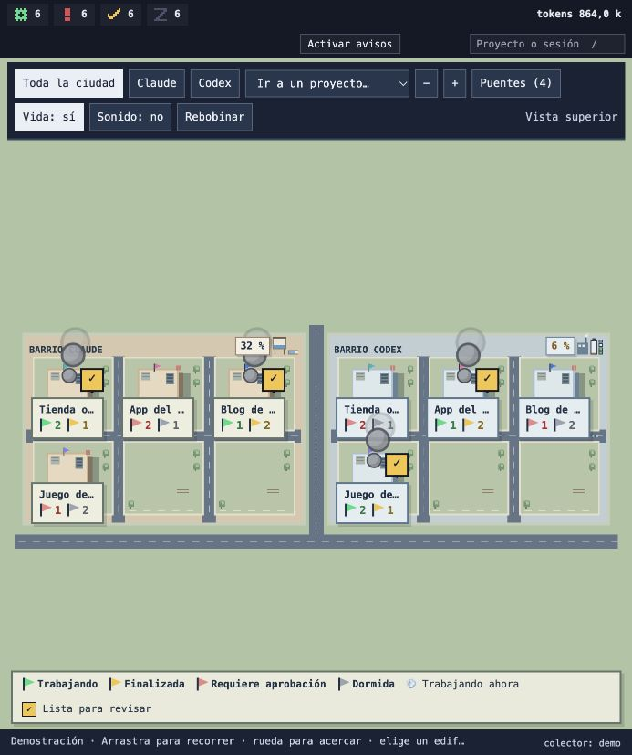
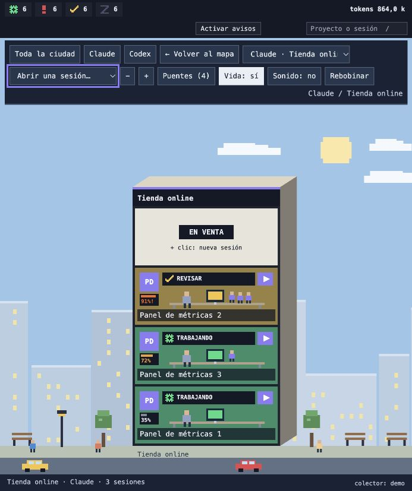
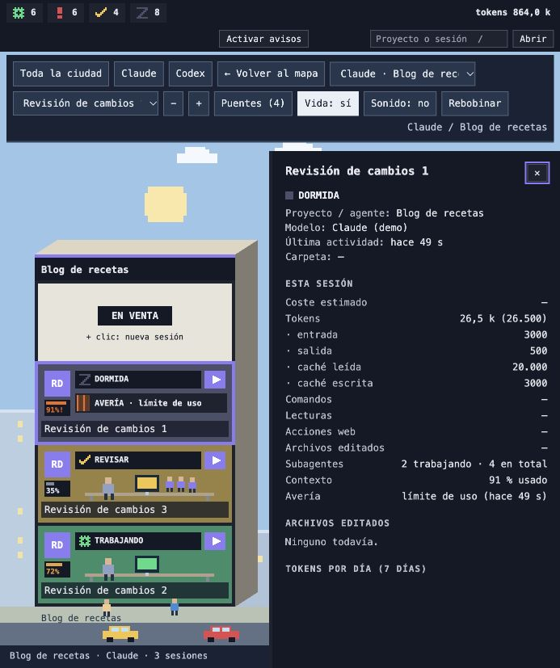

# Ciudad de agentes

Una ciudad 2.5D en el navegador para ver de un vistazo todas tus sesiones de Claude Code y Codex:

- **Barrio por proveedor** (Claude, Codex), **edificio por proyecto Git** y **piso por sesión**.
- **Color del piso según el estado**: trabajando, te necesita (pide permiso), para revisar (ya respondió) y dormida.
- **Señales en la azotea**: humo mientras se trabaja, cartel amarillo ✓ cuando hay algo listo para revisar y una bandera por estado bajo el nombre del edificio.
- **Subagentes**: un ayudante pequeño en el piso por cada subagente trabajando.
- **Avería y contexto**: cartel de avería si la última respuesta fue un error de la API (límite de uso, sesión caducada) y barra con el % de contexto usado, en ámbar desde el 70 % y en naranja desde el 85 %.
- **Rebobinar**: elige un día de la última semana y mira con un deslizador, o reproduciéndolo, cómo cambió la ciudad hora a hora.
- **Proyectos relacionados**: el mismo proyecto en Claude y en Codex, o los que vincules a mano, comparten banderín de color.
- **Panel de detalle**: tokens, coste estimado (los subagentes incluidos), herramientas usadas, archivos editados, subagentes, contexto, gráfico de 7 días y bitácora sin contenido.
- **Límites de uso**: depósito de agua (Claude) y central eléctrica (Codex), con lo que queda en la ventana de 5 h y en la semanal.
- **Avisos**: avioneta con pancarta, notificación del sistema y campanilla opcional cuando algo te necesita o termina.
- **Acciones desde la fachada**: abrir una sesión en su app, crear una nueva o mandarla a la Papelera.



| Fachada de un proyecto | Panel de una sesión |
|---|---|
|  |  |

Capturas actualizadas el 24 de octubre de 2026 con la demo (`?demo=24&projects=4`): Tienda online, App del clima, Blog de recetas y Juego de ajedrez. Todos los proyectos y sesiones son inventados.

Todo corre en tu máquina. El colector solo escucha en `127.0.0.1` y nada sale de ella.

## Requisitos

- macOS, Linux o Windows. macOS es donde se usa a diario; Linux y Windows tienen soporte, pero de momento solo está probado con tests que simulan cada sistema (ver «Sistemas operativos»).
- Node.js 22.12 o posterior (probado con 26).
- Claude Code y/o Codex.

## Instalación

```bash
git clone https://github.com/jfpazto/agent-city.git && cd agent-city
./init.sh                 # instala dependencias y pasa typecheck y tests
npm run hooks:install     # añade los hooks y la statusline a ~/.claude/settings.json (con copia .bak)
npm run dev               # colector en 127.0.0.1:4317 y front en http://localhost:5173
```

En Windows, si no tienes Git Bash para `./init.sh`, usa `npm install && npm test`.

Para que el colector arranque solo: `npm run autostart:install`. Para quitarlo todo: `npm run autostart:uninstall && npm run hooks:uninstall`.

Si ya tienes una statusline propia, el instalador no la toca. El depósito de Claude se queda «sin dato» hasta que tu statusline reenvíe también su entrada a `packages/collector/hook/statusline.sh`.

Codex no necesita instalar nada: se leen sus rollouts de `~/.codex/sessions`.

## Privacidad y seguridad

- Los hooks hacen un `curl` a `127.0.0.1` con un timeout de 1 s y siempre salen con código 0: nunca bloquean Claude Code.
- `/hook` y `/usage/claude` rechazan las peticiones de navegador (con Origin o sin `application/json`). Las acciones (abrir, crear, borrar) y el WebSocket solo aceptan el front local (puerto 5173, o los de `CIUDAD_WEB_PORTS`).
- `data/events/` guarda solo metadatos de cada hook, sin prompts ni entradas de herramientas, y borra los días con más de 7 de antigüedad. Rebobinar se construye a partir de estos metadatos.
- De la statusline solo se usan los límites de uso y el % de contexto; el resto se descarta.
- La bitácora guarda tipos de acción, nunca el contenido. De Codex no se guarda el texto de los mensajes.

## Configuración

| Variable | Por defecto | Qué hace |
|---|---|---|
| `COLLECTOR_PORT` | 4317 | Puerto del colector. Los hooks usan `CIUDAD_PORT`, con el mismo valor por defecto. |
| `CIUDAD_WEB_PORTS` | (vacío) | Puertos extra, separados por comas, desde los que el front puede hablar con el colector. |
| `CIUDAD_IDLE_MINUTES` | 30 | Minutos sin actividad para que un piso pase a dormida. |
| `CIUDAD_CLAUDE_DAYS` / `CIUDAD_CODEX_DAYS` | 2 / 7 | Días de sesiones que se cargan al arrancar. |
| `CIUDAD_EVENTS_DAYS` | 7 | Días que se conservan en `data/events/`. |
| `CIUDAD_EVENTS_FULL` | (vacío) | Con `1` guarda los eventos íntegros. Solo para estudiar formatos nuevos. |
| `CIUDAD_DATA_DIR`, `CIUDAD_TRANSCRIPTS_DIR`, `CIUDAD_CODEX_DIR`, `CIUDAD_PRICES_FILE` | | Rutas alternativas. |

## Modo demo

`http://localhost:5173/?demo=24&projects=4` pinta una ciudad de ejemplo sin colector. Con `npm run dev:web` basta para verla.

## Sistemas operativos

| | macOS | Linux | Windows |
|---|---|---|---|
| Hooks y statusline | `send.sh` / `statusline.sh` (curl) | igual que macOS | `send.mjs` / `statusline.mjs` (Node) |
| Abrir una sesión o crear una nueva | app de escritorio (`claude://`, `codex://`); si no, Terminal | `xdg-open`; si no, la primera terminal disponible (`x-terminal-emulator`, GNOME, Konsole, xterm) | app de escritorio; si no, una ventana de `cmd` |
| Eliminar una sesión | Papelera (`~/.Trash`) | papelera del escritorio (`~/.local/share/Trash`, restaurable) | Papelera de reciclaje (PowerShell) |
| Arranque automático | launchd | servicio de usuario de systemd | lanzador en la carpeta Inicio |
| Probado | a diario | tests que simulan el sistema | tests que simulan el sistema |

Si lo pruebas en Linux o Windows y algo falla, abre un issue con el sistema y el mensaje del colector (`data/collector.log`).

## Licencia

MIT. Ver `LICENSE`.

## Documentación

`ARCHITECTURE.md` (estructura), `CONTEXT.md` (vocabulario), `DESIGN.md` (diseño visual), `docs/pruebas-manuales.md` (cómo probar cada función) y `AGENTS.md` (instrucciones para agentes de código).
